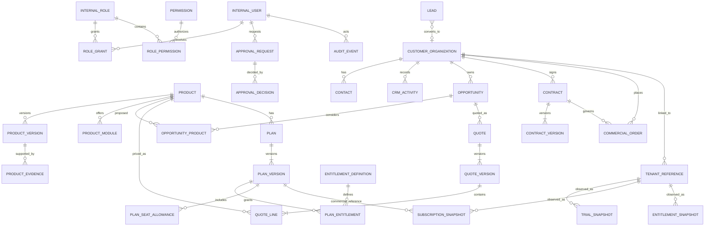

# MALVIA Company Management — Phase B Logical ERD v1

**Status:** Design specification only — not approved for physical schema implementation.  
**Parent scope:** [Phase B Scope & Acceptance Criteria](MALVIA-COMPANY-MANAGEMENT-PHASE-B-SCOPE-v1.md)  
**Boundary:** MALVIA internal company operating system; distinct from customer tenant operational databases.

## 1. Design principles

1. The internal Company Management bounded context owns MALVIA's corporate CRM, product catalogue, commercial pipeline and internal approvals.
2. Customer tenant and subscription lifecycle authorities remain in the shared MALVIA Platform. This ERD stores controlled references and read-model snapshots only.
3. Internal users, customer users, contacts and tenant members are distinct identities.
4. A legal/commercial customer organization is not a Platform Tenant. The relationship is explicit, verified, and potentially one-to-many.
5. Product, product module, plan, plan version, quote, contract, order, subscription, invoice and payment are distinct concepts.
6. Important commercial and lifecycle history is append-only or versioned. Updates must not erase the prior approved state.
7. All business records carry stable IDs, timestamps and audit correlation. Tenant-facing customer data is not copied into the internal domain.
8. This document is logical. It does not prescribe SQL types, indexes, physical table names, RLS policies, migrations or database vendor.

## 2. Bounded contexts and ownership

| Context | Owns | Does not own |
|---|---|---|
| Internal Identity & Access | InternalUser, InternalRole, Permission, RoleGrant, Session reference | Customer login, tenant membership |
| Product Portfolio | Product, ProductVersion, ProductModule, ProductEvidence | Runtime product configuration |
| CRM | Lead, Contact, CustomerOrganization, Activity, Opportunity | Customer operational records |
| Commercial | Quote, QuoteVersion, QuoteLine, Contract, ContractVersion, Order, Approval | Payment processing, legal signature provider |
| Catalogue | Plan, PlanVersion, EntitlementDefinition, SeatAllowance | Effective customer entitlement state |
| Platform Read Models | TenantReference, TrialSnapshot, SubscriptionSnapshot, EntitlementSnapshot | Tenant provisioning and lifecycle mutations |
| Governance | ApprovalRequest, ApprovalDecision, AuditEvent, AttachmentReference | Binary document storage itself |

**Authority rule:** Platform tenant/trial/subscription services are authoritative for their lifecycle states. The internal system may store a timestamped projection for reporting, but must not write back through this read model.

## 3. Logical ERD

The diagram is conceptual. Optional relationships and exact cardinalities are governed by the detailed rules below.

## 4. Identity and access entities

### 4.1 InternalUser
- `internal_user_id` — immutable identifier.
- `display_name`, `login_identifier`, `work_email` (optional), `status`.
- `authentication_subject` — opaque reference to the approved identity provider; no password material in this domain.
- `created_at`, `updated_at`, `last_seen_at`.

Rules:
- Unique active login identifier within the internal identity realm.
- Deactivation blocks new sessions and privileged actions; it does not erase audit history.
- No implicit link to a customer Contact or TenantMember.

### 4.2 InternalRole, Permission, RoleGrant, RolePermission
- Role: stable code, name, scope type, status.
- Permission: resource, action, scope, risk classification.
- RoleGrant: internal user, role, scope reference, validity interval, granting actor.
- RolePermission: role, permission, optional conditions.

Authorization must be enforced server-side for every read and command. UI visibility is not an authorization control. High-risk permission changes require a separate approval policy.

## 5. Product portfolio entities

### 5.1 Product
- `product_id`, `product_code` (unique), `name`, `industry_code`, `description`.
- `maturity_state`: Planned | InDevelopment | PrivatePilot | Available | Deprecated.
- `product_owner_user_id`, `support_readiness_state`, `commercial_state`.
- timestamps and audit actor.

### 5.2 ProductVersion
- `product_version_id`, `product_id`, `version_label`, `release_channel`.
- `release_reference`, `release_date`, `verification_state`, `supersedes_version_id`.
- A version is immutable after release approval; corrections create a new version/evidence record.

### 5.3 ProductModule
- `product_module_id`, `product_id`, `module_code`, `name`, `status`.
- Modules are product capabilities; they are not standalone products or commercial plans unless explicitly catalogued as such.

### 5.4 ProductEvidence
- `evidence_id`, `product_version_id`, `evidence_type`, `reference_uri`, `review_status`, `reviewed_by`, `reviewed_at`.
- Evidence types include QA, security, release, support readiness and owner approval.
- Only controlled metadata and references are stored; binaries live in approved document storage.

Invariant: Product maturity cannot become Available unless the required evidence set and authorized approval are present.

## 6. CRM entities

### 6.1 CustomerOrganization
- `customer_org_id`, `legal_name`, `display_name`, `industry_code`, `country_code`.
- `lifecycle_state`, `account_owner_user_id`, `source`, `verification_state`.
- Optional registration/tax identifiers are restricted fields with explicit purpose and access policy; do not collect them unless needed.
- timestamps, soft-delete marker and audit actor.

### 6.2 Contact
- `contact_id`, `customer_org_id` (nullable for unqualified lead contacts), `name`, `role_title`.
- `email`, `phone`, `preferred_channel`, `consent_state`, `status`.
- Contact details are personal data: least-privilege access, retention policy and export controls required.

### 6.3 Lead
- `lead_id`, `source`, `stage`, `owner_user_id`, `primary_contact_id`, `candidate_customer_org_id`.
- `industry_interest`, `product_interest_codes`, `qualification_summary`, `lost_reason_code`.
- Conversion is explicit and audited. It may link to an existing organization after review; never auto-create duplicates silently.

### 6.4 CRMActivity
- `activity_id`, `customer_org_id`, `contact_id`, `lead_id`, `opportunity_id` (applicable links only).
- `activity_type`, `subject`, `occurred_at`, `created_by`, `visibility_scope`, `outcome`.
- Do not store secrets, passwords, payment credentials or unnecessary sensitive personal information in notes.

### 6.5 Opportunity and OpportunityProduct
- Opportunity: `opportunity_id`, `customer_org_id`, `owner_user_id`, `stage`, `expected_close_date`, `probability`, `currency_code`, `amount`, `loss_reason_code`.
- OpportunityProduct: `opportunity_product_id`, `opportunity_id`, `product_id`, `scope_summary`, `estimated_amount`, `currency_code`.
- Opportunity amount is a forecast, not revenue or an accounting balance.
- Currency-specific totals remain separate unless a governed FX policy is later approved.

## 7. Commercial entities

### 7.1 Quote and QuoteVersion
- Quote: `quote_id`, `opportunity_id`, `customer_org_id`, `status`, `current_version_id`.
- QuoteVersion: `quote_version_id`, `quote_id`, `version_number`, `currency_code`, `valid_until`, `terms_reference`, `created_by`, `sent_at`, `approval_state`.
- QuoteLine: `quote_line_id`, `quote_version_id`, `product_id` or approved service code, `description`, `quantity`, `unit_price`, `discount`, `line_total`.
- Sent/approved versions are immutable. A revision creates a new version and preserves the old one.

### 7.2 Contract and ContractVersion
- Contract: `contract_id`, `customer_org_id`, `opportunity_id`, `status`, `effective_version_id`.
- ContractVersion: `contract_version_id`, `contract_id`, `version_number`, `document_reference`, `approval_state`, `signature_state`, `effective_from`, `effective_to`.
- A document reference is not proof of legal signature by itself. Signature workflow and legal requirements remain out of Phase B.

### 7.3 CommercialOrder
- `order_id`, `customer_org_id`, `contract_id`, `quote_version_id`, `status`, `accepted_at`.
- `ordered_product_refs`, `commercial_notes`, `created_by`.
- An order records commercial commitment only. It does not provision tenants, activate entitlements or post invoices.

### 7.4 ApprovalRequest and ApprovalDecision
- ApprovalRequest: `approval_request_id`, `target_type`, `target_id`, `approval_type`, `requested_by`, `status`, `policy_version`, `created_at`.
- ApprovalDecision: `approval_decision_id`, `approval_request_id`, `decision`, `decided_by`, `reason`, `decided_at`.
- A requester cannot approve their own request where policy requires separation of duties.
- Decisions are immutable; correction is a new decision/reversal event with reason.

## 8. Plan and entitlement catalogue entities

### 8.1 Plan and PlanVersion
- Plan: `plan_id`, `product_id`, `plan_code`, `display_name`, `commercial_status`.
- PlanVersion: `plan_version_id`, `plan_id`, `version_number`, `billing_interval`, `currency_code`, `base_price`, `effective_from`, `effective_to`, `approval_state`.
- Approved plan versions are immutable. New commercial terms create a new version.

### 8.2 EntitlementDefinition and PlanEntitlement
- EntitlementDefinition: `entitlement_id`, `entitlement_code`, `description`, `unit`, `scope`.
- PlanEntitlement: `plan_entitlement_id`, `plan_version_id`, `entitlement_id`, `quantity_or_limit`, `enabled`.
- Entitlement catalogue metadata is not the effective entitlement granted to a tenant; Platform remains authoritative.

### 8.3 PlanSeatAllowance
- `seat_allowance_id`, `plan_version_id`, `seat_type`, `included_quantity`, `billable`.
- Confirmed basic plan: `OWNER_ACCOUNT = 1` and `EMPLOYEE_SEAT = 2`.
- Owner is not included in the employee-seat count.
- Branch count is not a seat type and is not capped by this model.
- Additional-seat pricing and higher tiers remain unapproved catalogue placeholders.

## 9. Platform read-model entities

### 9.1 TenantReference
- `tenant_reference_id`, `platform_tenant_id` (opaque external ID), `customer_org_id`, `link_verification_state`.
- `platform_status`, `product_summary`, `reported_owner_ref`, `employee_seat_count`, `branch_count`.
- `source_system`, `source_updated_at`, `observed_at`, `freshness_state`.
- Unique constraint on source system + platform tenant ID.
- Link/unlink is an audited internal relationship operation; it does not alter the tenant.

### 9.2 TrialSnapshot
- `trial_snapshot_id`, `tenant_reference_id`, `external_trial_id`, `product_id`, `server_state`.
- `server_started_at`, `server_expires_at`, `observed_at`, `source_updated_at`, `freshness_state`.
- Duration policy label = 14 days. Exact clock/expiry semantics remain pending.
- Snapshots are append-only observations or replaceable projections with retained observation history; never a command source.

### 9.3 SubscriptionSnapshot and EntitlementSnapshot
- SubscriptionSnapshot: `subscription_snapshot_id`, `tenant_reference_id`, `external_subscription_id`, `plan_version_id` (nullable until matched), `server_state`, `effective_from`, `effective_to`, `observed_at`, `freshness_state`.
- EntitlementSnapshot: `entitlement_snapshot_id`, `tenant_reference_id`, `entitlement_code`, `effective_value`, `observed_at`, `source_updated_at`.
- A snapshot cannot authorize a tenant action or overwrite the Platform's authoritative state.
- Missing or stale source values remain explicitly unknown/stale, not zero or Active.

## 10. Audit and attachment entities

### 10.1 AuditEvent
- `audit_event_id`, `actor_internal_user_id`, `action`, `target_type`, `target_id`.
- `occurred_at`, `request_id`, `correlation_id`, `reason_code`, `change_summary`, `source_ip_fingerprint` (only if approved).
- Append-only; access to audit logs is separately permissioned. Avoid storing credentials or full sensitive payloads.

### 10.2 AttachmentReference
- `attachment_reference_id`, `owner_type`, `owner_id`, `storage_provider`, `opaque_object_key`.
- `file_name`, `media_type`, `size_bytes`, `checksum`, `classification`, `uploaded_by`, `created_at`.
- Actual file bytes are stored in approved private object storage. Download uses short-lived authorized access; never public-by-default URLs.

## 11. Key cardinalities and integrity rules

1. A CustomerOrganization can have many Contacts, Leads, Opportunities, Contracts, Orders and TenantReferences.
2. A Lead may convert to zero or one CustomerOrganization; conversion records the selected target and actor.
3. An Opportunity can include multiple products; quote lines are tied to a specific immutable QuoteVersion.
4. A Contract can have multiple versions and orders; an Order references the accepted quote version and applicable contract.
5. A Product can have multiple plans; a Plan has multiple immutable PlanVersions.
6. A PlanVersion can define many entitlements and seat allowances; a SubscriptionSnapshot refers to the exact version when confidently mapped.
7. One CustomerOrganization can link to multiple Platform tenant references; each external tenant reference maps to at most one verified organization at a time unless a separately approved legal-ownership model supports shared ownership.
8. Tenant references are not foreign keys into customer operational tables.
9. Internal users and tenant members never share a principal ID namespace or session realm.
10. Monetary values require ISO currency code and fixed precision at physical-design stage; do not aggregate mixed currencies.
11. Time instants are stored as timezone-aware instants; user-facing rendering uses the configured timezone. Trial clock policy is still pending.
12. All state transitions and privileged mutations record audit events in the same logical transaction or through a reliable transactional outbox.

## 12. Retention, privacy and security notes

- Define lawful purpose, retention period and deletion/anonymization rules before collecting personal data.
- CRM contact data, support notes and commercial attachments are classified and permissioned.
- Do not import customer tenant employees, invoices, transactions, inventory or HR records into this domain.
- Use opaque external IDs; avoid exposing internal primary keys in public URLs.
- Audit logs are append-only and protected from ordinary record editors.
- Exports must enforce the same row/field scope as interactive reads and produce an audit event.
- No support impersonation or customer data access is designed into Phase B.

## 13. Physical-design gates

Before translating this logical model into a physical schema:
1. Approve internal identity provider, MFA, session and recovery policy.
2. Approve role/scope model and separation-of-duties rules.
3. Approve contact-data purpose, retention, export and deletion policy.
4. Agree Platform API ownership and stable external identifiers.
5. Define snapshot freshness thresholds and reconciliation cadence.
6. Approve commercial authority thresholds and quote/contract lifecycle.
7. Decide currency and rounding rules for quotes; no finance ledger is implied.
8. Decide trial clock/expiry semantics and which source exposes the authoritative timestamps.
9. Review threat model, audit integrity, attachment access and backup/restore.
10. Complete physical database design, constraints and migration review separately.

**Non-authorization:** This document does not authorize SQL/DDL, migrations, runtime implementation, customer data access, tenant lifecycle commands or Production deployment.

## Phase B traceability

- [Phase B Traceability Matrix](MALVIA-COMPANY-MANAGEMENT-PHASE-B-TRACEABILITY-MATRIX-v1.md) maps each screen and capability to these logical entities, authorization boundaries, proposed APIs and acceptance tests. It is a design aid only and does not authorize physical schema or runtime implementation.

## Phase B0 boundary

- [Phase B0 Design Lock & Decision Closure](MALVIA-COMPANY-MANAGEMENT-PHASE-B0-DESIGN-LOCK-v1.md) records the identity, tenant-data, Platform authority, commercial separation and audit invariants that must be approved before physical design. This logical ERD remains non-physical and non-implementation-authorizing.
